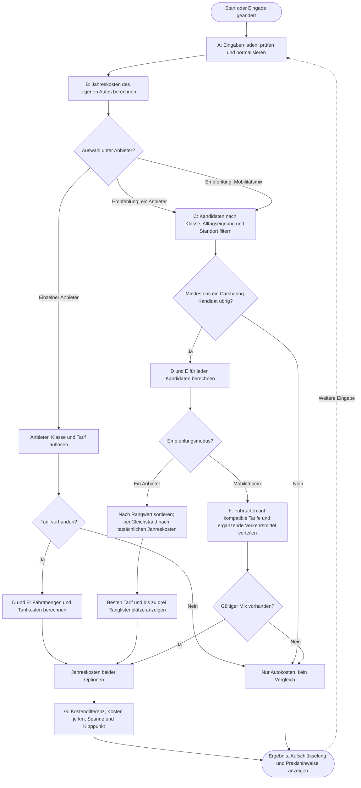
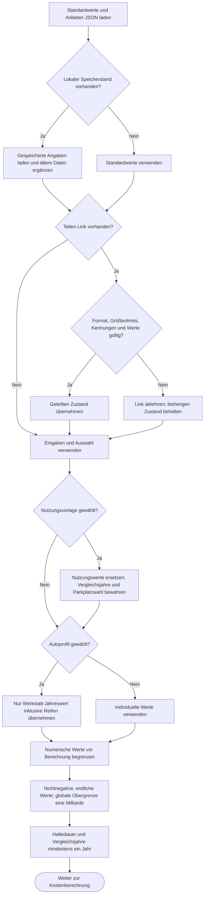
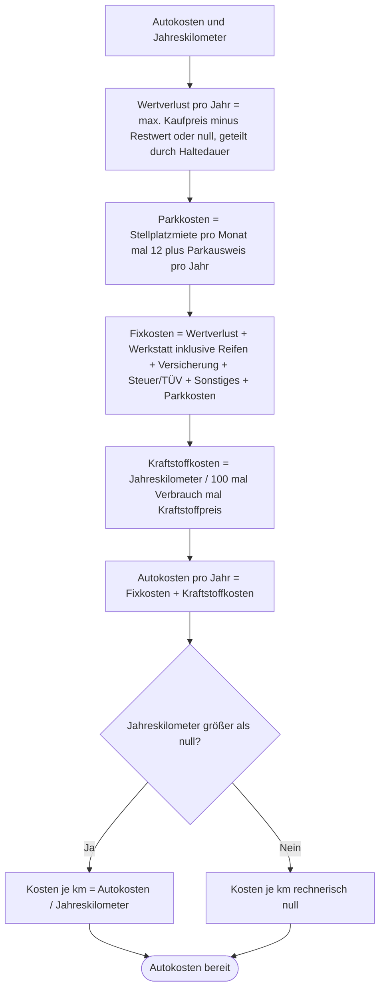
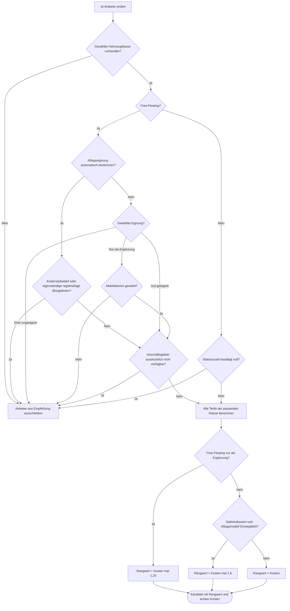
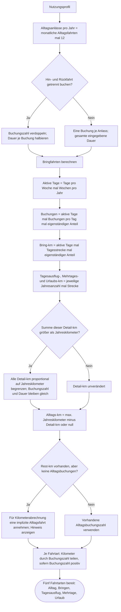
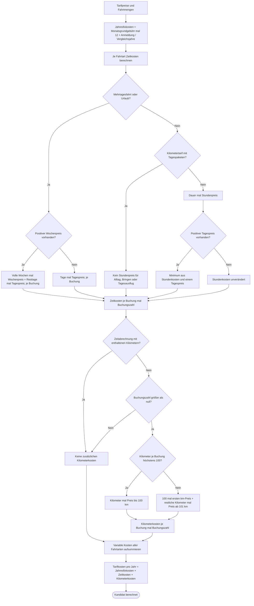
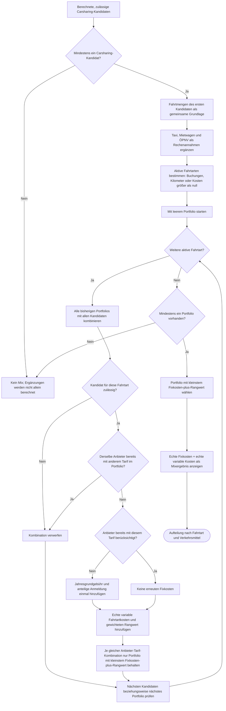
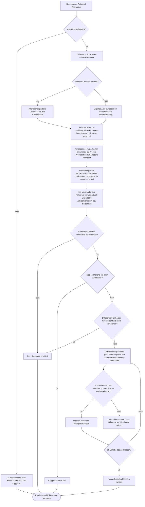

# Ablauf der gesamten Kalkulation

Stand: 21. Oktober 2026. Diese Dokumentation beschreibt den aktuellen Code, einschließlich seiner Vereinfachungen. Die Diagramme zeigen den Gesamtablauf und die verzweigten Teilberechnungen. Rauten sind Entscheidungen; ihre Kanten benennen Ja/Nein oder die jeweilige Auswahl.

## 1. Gesamtablauf

Die Unterprozesse A bis G werden anschließend genauer dargestellt. Standort und Alltagseignung steuern die Empfehlungen; die Kosten eines manuell ausgewählten Tarifs werden unabhängig davon berechnet.

## 2. A – Eingaben und Vorlagen

- Zahlenfelder sperren Minuszeichen und prüfen zusätzlich ihre Feldgrenzen. Die Berechnung begrenzt Zahlen erneut. Ungültige Import- oder Linkdaten werden abgewiesen.
- Die sechs Autoprofile setzen ausschließlich den Posten Wartung, Reparaturen und Reifen. Die Werte skalieren nicht automatisch mit der Fahrleistung.
- Reifen sind in diesem Werkstattposten enthalten. Ein eventuell früher im Feld Steuer/TÜV erfasster Reifenanteil muss manuell abgezogen werden.
- „Autodaten zurücksetzen“ stellt die Autokosten und die Parkplatzwahl auf Beispielvorgaben zurück. Es ersetzt nicht das Fahrprofil, den Standort oder die Tarife.
- Die Eingabepfade sind mögliche Aktionen, keine bei jeder Änderung erneut durchgeführte Speicher- oder Linkabfrage.

## 3. B – Eigenes Auto

„Fixkosten“ ist die Gruppierung der Oberfläche: Auch der hier angesetzte Jahresbetrag für Wartung und Verschleiß steht in dieser Summe. Eine automatische kilometerabhängige Werkstattberechnung gibt es nicht. Der Schalter für einen garantierten Stellplatz beeinflusst nur die Hinweise zur Parkplatzsuche; beide eingegebenen Parkkosten zählen unabhängig davon.

## 4. C – Zulässige Anbieter und Gewichtung

Diese Filter gelten für automatische Empfehlungen. Die Standortauswahl verwendet dieselben Regeln für Fahrzeugklasse und Alltagseignung, lässt aber als nicht verfügbar markierte Anbieter zur Korrektur ihrer Angaben weiterhin auswählen.

- Stationszahl null gilt als bestätigt, wenn sie aus manueller Eingabe oder Stationssuche stammt. Fehlende und ältere unbestätigte Standortwerte schließen einen Anbieter nicht automatisch aus.
- Bei Free-Floating erfolgt keine OSM-Stationssuche. Entscheidend sind Geschäftsgebiet und Fahrzeugverfügbarkeit in der Anbieter-App.
- Fehlende Standortbestätigung wird als Einschränkung der Empfehlung angezeigt. Gehzeit beeinflusst Praxishinweise, aber weder Tarifpreis noch Rangwert numerisch.
- Kindersitzbedarf bedeutet: mindestens ein benötigter Sitz oder ein noch zu prüfender älterer Kindersitz-Eintrag. Sitz-Ausstattung erzeugt Hinweise, keinen Kostenaufschlag.
- Rangfaktoren verändern nur die Reihenfolge, niemals die angezeigten Eurobeträge. Beim Einzelanbieter werden die gesamten Tarifkosten gewichtet; im Mix die variablen Kosten je Fahrtart. Mix-Grundgebühren bleiben ungewichtet.

## 5. D – Jahresfahrten und Kilometerverteilung

Bei der impliziten Alltagsfahrt wird kein zusätzlicher Zeitpreis erzeugt. Die angegebenen Bring-km sind die gesamte Tagesstrecke, nicht die Strecke jeder einzelnen Buchung.

## 6. E – Tarifberechnung pro Kandidat

Die Paketlogik bildet den aktuellen Code ab: volle Wochen plus Resttage. Sie sucht nicht sämtliche günstigsten Kombinationen aus Stunden-, Tages- und Wochenpaketen. Beim Tarifmodell „Zeit, Kilometer inklusive“ wird derzeit kein begrenztes Freikilometerkontingent modelliert.

## 7. F – Mobilitätsmix

Der Kandidaten-/Portfolio-Schritt wird für jede Fahrtart vollständig durchlaufen, bevor die nächste Fahrtart beginnt.

| Ergänzung | Zulässige Fahrtarten | Rechenannahme |
|---|---|---|
| Taxi / Ridehailing | Alltag, Bringfahrten | 4 € je Buchung + 2,20 €/km |
| Mietwagen | Tagesausflug, Mehrtage, Urlaub | 55 €/Tag + 0,18 €/km; Dauer bei Mehrtagen/Urlaub mindestens ein Tag |
| ÖPNV / Deutschlandticket | Alltag, Bringfahrten | 63 €/Monat, also 756 €/Jahr, einmal im Portfolio |

Diese Ergänzungen sind keine Live-Angebote. Ihre lokale Verfügbarkeit wird nicht automatisch geprüft. Ein Mix darf nur einen Tarif pro Anbieter verwenden; er ist nicht auf zwei Anbieter begrenzt.

## 8. G – Vergleich, Spanne und rechnerischer Kipppunkt

- Die Spannen sind feste Modellannahmen, keine statistischen Konfidenzintervalle.
- Beim Kipppunkt werden in Empfehlungsmodi auch Anbieterwahl und Mobilitätsmix erneut berechnet. Die übrigen Fahrtenzahlen und Dauern bleiben unverändert; die Kilometerverteilung wird erneut begrenzt.
- Die Halbierung prüft einen Vorzeichenwechsel an den Grenzen. Sie findet nicht zuverlässig mehrere mögliche Schnittpunkte bei nicht monotonen Kostenverläufen.
- Wenn kein Kipppunkt ermittelt wird, zeigt die Oberfläche bei vorhandenem Vergleich „Bis 50.000 km/Jahr kein Kostengleichstand“. Das bedeutet technisch, dass diese Suchmethode keinen Wert liefert.
- Praxishinweise zu Kindersitzen, Parkplatzsuche, Standort, Tarifstand und Buchbarkeit werden ergänzend dargestellt; sie erzeugen keine zusätzlichen Kosten außerhalb der dokumentierten Rangfaktoren.

## Zugehöriger Code

| Datei | Verantwortlichkeit |
|---|---|
| [calculator.js](calculator.js) | Normalisierung, eigenes Auto, Fahrtmengen, Kilometerstaffeln, Zeit- und Paketkosten |
| [recommendations.js](recommendations.js) | Eignungsfilter, Standortausschluss, Rangwerte, Einzelanbieter und Mobilitätsmix |
| [app.js](app.js) | Zustandsübernahme, Vorlagen, Standortkontext, Ergebnisdarstellung, Spannen und Kipppunkt |
| [providers.js](providers.js) | Standardwerte und Normalisierung von Autokosten und Tarifen |
| [own-car-profiles.js](own-car-profiles.js) | Jahresmittelwerte der sechs Autoprofile |
| [data-limits.js](data-limits.js) und [identifier-validation.js](identifier-validation.js) | Zahlen-, Größen- und Kennungsgrenzen |
| [data/providers](data/providers) | Gepflegte Anbieter- und Tarifquellen |

Ändert sich eine der Berechnungsregeln, sollten der zugehörige Entscheidungszweig und die Erläuterung in dieser Datei gemeinsam aktualisiert werden.
